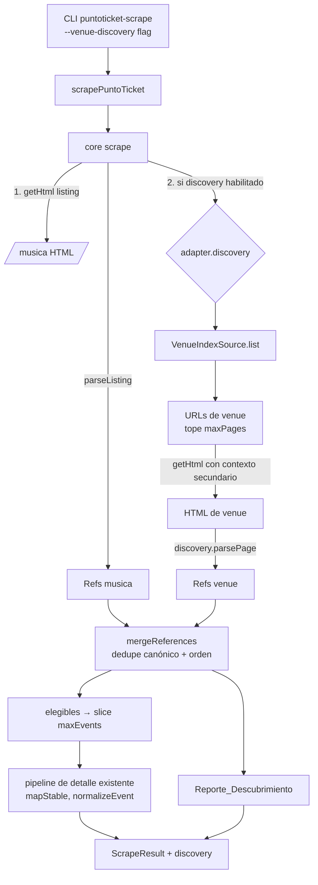

# Documento de Diseño: Descubrimiento de eventos por venue en PuntoTicket

## Overview

Se agrega una segunda vía de descubrimiento (páginas de venue) al scraper de PuntoTicket, además del listado `/musica`. Las referencias de ambas vías se unen, se deduplican por `source_url` canónica y alimentan el pipeline de detalle existente sin cambios. Se produce un `Reporte_Descubrimiento` con los eventos que `/musica` no mostraba.

Decisiones de diseño clave:

- **Hook opcional en el core.** `SourceAdapter` gana un campo opcional `discovery`. Si falta o está deshabilitado, `scrape()` ejecuta exactamente el mismo camino que hoy. Ticketmaster y `/musica` no se tocan.
- **Índice de venues enchufable.** El core y el adapter dependen de la interfaz `SecondaryIndexSource`. Tras las decisiones de TL/PO, la fuente real es `db-venues` (tabla `venue_sources`); `fixed-list` queda como respaldo y pruebas (ver "Fase 2: decisiones de TL/PO").
- **Cambios de esquema DB en la fase 2** (tabla `venue_sources` y columna `scrape_runs.discovery_report`). El diseño base (tareas 1-10, implementado) no tocaba el esquema; el reporte viaja además en el resultado de la corrida y en la salida del CLI.
- **Identidad única:** `source` + `canonicalSourceUrl` (de `@mishow/domain`). El origen de descubrimiento es metadato del reporte, no del `NormalizedEvent`.

### Hallazgos de la investigación del código

| Pieza | Hallazgo | Implicancia |
|---|---|---|
| `scrapers/core/src/acquisition/orchestrator.ts` | `scrape()` valida una sola `listingUrl`, parsea con `adapter.parseListing`, filtra con `validateAcquisitionUrl(..., "detail", ...)`, recorta a `maxEvents` y procesa detalles con `mapStable` (concurrencia ≤ 2). Fallos de listado lanzan error global. | Punto de inserción: entre `parseListing` y el filtro de elegibles. |
| `scrapers/core/src/acquisition/policy.ts` | `validateAcquisitionUrl(stage="listing")` exige `adapter.isListingPath`, y elimina `search`/`hash`. `acquisitionConfig` valida límites (concurrencia ≤ 2, delay ≥ 1000, retries ≤ 2, etc.). | Las páginas de venue no pasan `isListingPath`; hace falta una variante de validación sin ampliar `AcquisitionStage`. |
| `scrapers/core/src/acquisition/http.ts` | `HttpClient.getHtml(url, stage, context)` aplica política, redirecciones revalidadas, reintentos (408/429/5xx), `RequestLimiter` que serializa todas las solicitudes con `delayMs`, y solo acepta `text/html`/`xhtml`. 401/403 → `http_error` sin reintento. | Límites de cortesía se heredan si todas las solicitudes pasan por la misma instancia de `HttpClient`. Un `sitemap.xml` (XML) sería rechazado por `invalid_content_type`. |
| `scrapers/core/src/adapter.ts` | `SourceAdapter` es interfaz con `isListingPath`, `isDetailPath`, `isBlockedPath`, `parseListing`, `parseDetail`, `extractDetail`. | Se extiende con un campo opcional (compatible). |
| `scrapers/core/src/persistence/workflow.ts` y `mapping.ts` | `recordError` valida `error.source_url` con `canonicalSourceUrl`. Etapas de error permitidas: `listing|detail|parse|normalize|persist`. `scrape_runs` guarda conteos `discovered/attempted/succeeded/failed`. | Los errores de venue deben usar URLs canónicas y etapas existentes (`listing`, `parse`). Los conteos de `scrape_runs` no cambian. |
| `scrapers/puntoticket/src/adapter.ts` | `isListingPath` acepta solo `/musica`. `isBlockedPath` bloquea `/musica`, `/deportes`, `/teatro`, etc. salvo `listing` en `/musica`; **no** bloquea `/recintos`. | Una ruta de venue como `/recintos/...` no queda bloqueada por `isBlockedPath`, pero tampoco está permitida por ninguna regla. Debe habilitarse explícitamente. |
| `scrapers/puntoticket/src/extraction/listing.ts` | `parseMusicListing` descarta `/recintos` (`NON_EVENT_PATH`) y reconoce `/evento/<slug>` y landings raíz dentro de tarjeta de evento (`isEventCardLink`). `eventTitle` es reutilizable. | El parser de venue reutiliza esas reglas sin modificar `parseMusicListing` (exportando helpers internos). |
| `scrapers/puntoticket/src/acquisition/orchestrator.ts` | `scrapePuntoTicket(options)` solo delega en `scrape({ adapter: puntoticketAdapter, ...options })`. | Se agrega una opción opcional `discovery`; los llamadores actuales no cambian. |
| `packages/domain/src/url.ts` | `canonicalSourceUrl` baja `search`/`hash`, quita `/` final, valida host, userinfo y separadores codificados. El host queda en minúsculas por `URL`. El path **no** se normaliza a minúsculas. | Define la clave de dedupe. Se asume que el path es sensible a mayúsculas. |
| Pruebas | Vitest por paquete (`vitest run tests`). No hay `fast-check` en el repo. | PBT con PRNG propio con semilla fija. |

## Architecture



Flujo con discovery deshabilitado o ausente: se omiten los nodos 2, `MERGE` y `REP`; `references` es exactamente la salida de `parseListing`.

### Orden de ejecución

1. Listado `/musica` (sin cambios; si falla, fallo global como hoy).
2. Si `options.discovery?.enabled` y `adapter.discovery` existe: obtener índice de venues → solicitar páginas de venue (secuencial vía limiter compartido, concurrencia ≤ 2) → parsear.
3. Unir referencias: primero las de `/musica` en su orden original, luego las exclusivas de venue (orden de índice y de aparición).
4. Filtrar elegibles y recortar a `maxEvents` (las de `/musica` van primero, por lo que el recorte nunca desplaza eventos de `/musica` a favor de venue).
5. Detalle y normalización: sin cambios.

## Components and Interfaces

### Core (`scrapers/core`)

**`adapter.ts` (cambio aditivo)**

```ts
export interface AcquisitionUrlContext {
  discoveredDetailUrl?: string;
  /** Marca solicitudes de descubrimiento secundario (páginas de venue). */
  secondaryListing?: boolean;
}

export interface SecondaryDiscovery {
  readonly id: string; // p. ej. "venues"
  /** ¿La ruta es una página secundaria permitida? (allowlist explícita, no heurística) */
  isSecondaryPagePath(pathname: string): boolean;
  /** Fuente del índice de páginas secundarias (enchufable). */
  readonly index: SecondaryIndexSource;
  /** Extrae referencias de evento desde el HTML de una página secundaria. */
  parsePage(html: string, pageUrl: string): RawEventReference[];
}

export interface SecondaryIndexContext {
  getHtml(url: string): Promise<string>; // pasa por HttpClient con contexto secundario
}

export interface SecondaryIndexSource {
  readonly kind: string; // "fixed-list" | "sitemap" | "index-page" | "derived-from-details"
  list(ctx: SecondaryIndexContext): Promise<string[]>; // URLs absolutas candidatas
}

export interface SourceAdapter {
  /* ...campos existentes sin cambios... */
  readonly discovery?: SecondaryDiscovery; // opcional
}
```

`AcquisitionStage` **no** se amplía (`"listing" | "detail"`), para no romper `isBlockedPath` de otros adapters.

**`policy.ts` (cambio mínimo)**

En `validateAcquisitionUrl`, la rama `stage === "listing"` pasa a:

```ts
if (stage === "listing") {
  const ok = context.secondaryListing
    ? adapter.discovery?.isSecondaryPagePath(url.pathname) === true
    : adapter.isListingPath(url.pathname);
  if (!ok) throw new AcquisitionPolicyError("Listing no permitido.");
}
```

Con `secondaryListing` ausente el comportamiento es idéntico al actual. `isBlockedPath(pathname, "listing")` sigue aplicándose, de modo que las rutas de compra/cuenta quedan bloqueadas (Req 5.5).

**`discovery.ts` (nuevo, funciones puras)**

```ts
export type DiscoveryOrigin = "musica" | "venue";

export interface DiscoveryOptions {
  enabled: boolean;            // default false
  maxPages: number;            // default 10 (SUPUESTO PROVISIONAL)
}
export const DISCOVERY_HARD_MAX_PAGES = 25; // SUPUESTO PROVISIONAL, tope duro (Req 5.8)

export interface MergedReference {
  reference: RawEventReference;      // source_url canónica
  origins: DiscoveryOrigin[];        // orden: "musica" antes que "venue"
  venue_pages: string[];             // URLs de página de venue (solo informe)
}

export function canonicalKey(adapter: SourceAdapter, url: string): string | undefined;
export function mergeReferences(adapter: SourceAdapter, musica: RawEventReference[], venue: Array<{ page: string; refs: RawEventReference[] }>): MergedReference[];
export function buildDiscoveryReport(merged: MergedReference[], pages: VenuePagesSummary): DiscoveryReport;
export function serializeReferences(refs: RawEventReference[]): string;
export function deserializeReferences(text: string): RawEventReference[];
```

- `canonicalKey` usa `canonicalSourceUrl(url, "source_url", { host: adapter.host, purchasePathPatterns: adapter.purchasePathPatterns })`; devuelve `undefined` si lanza (la referencia se descarta y no entra al conteo).
- `mergeReferences` es total y determinista: no hace E/S.
- `serializeReferences` produce JSON estable (claves ordenadas: `source_url`, luego `title` solo si existe), una lista; `deserializeReferences` valida forma y lanza ante entrada mal formada.

**`orchestrator.ts` (cambio aditivo)**

```ts
export interface ScraperOptions {
  adapter: SourceAdapter;
  config?: Partial<AcquisitionConfig>;
  client: HttpClient;
  now: () => Date;
  discovery?: DiscoveryOptions;        // nuevo, opcional
}

export interface ScrapeResult {
  /* ...campos existentes... */
  discovery?: DiscoveryReport;         // presente solo si discovery se ejecutó
}
```

Cuando `discovery` es `undefined`, `enabled=false` o `adapter.discovery` es `undefined`: `references` = salida de `parseListing`, el resultado no incluye la clave `discovery` y es idéntico al actual (Req 2, 10.2).

Esquema de la rama habilitada (pseudocódigo TypeScript):

```ts
const pagesBudget = Math.min(opts.maxPages, DISCOVERY_HARD_MAX_PAGES);
let venueResults: Array<{ page: string; refs: RawEventReference[] }> = [];
const discoveryErrors: ScrapeError[] = [];
try {
  const candidates = await adapter.discovery.index.list({ getHtml: (u) => options.client.getHtml(u, "listing", { secondaryListing: true }) });
  const pages = uniqueCanonical(candidates).slice(0, pagesBudget);
  venueResults = await mapStable(pages, config.concurrency, fetchAndParsePage); // errores por página → discoveryErrors
} catch (e) {
  discoveryErrors.push(scrapeError("listing", undefined, "venue_index_failed", ...)); // continúa con /musica
}
const merged = mergeReferences(adapter, references, venueResults);
references = merged.map((m) => m.reference);
```

Manejo por página (`fetchAndParsePage`):

- URL fuera de política → `validateAcquisitionUrl(..., "listing", undefined, { secondaryListing: true })` lanza `AcquisitionPolicyError` → error `url_rejected`, stage `listing`, sin solicitud (Req 5.2).
- `HttpAcquisitionError` (incluye `redirect_rejected`, `http_error` por 401/403/429 tras reintentos) → stage `listing`, código del error, `source_url` = URL canónica de la página (Req 8.1, 5.10).
- `parsePage` lanza → stage `parse`, código `parse_error`, URL de la página (Req 1.5).
- Cero referencias → página contada como exitosa (Req 1.4).

`globalFailure` sigue aplicando solo al listado `/musica`.

### Adapter PuntoTicket (`scrapers/puntoticket`)

**`extraction/venue.ts` (nuevo)**

```ts
export function parseVenuePage(html: string, pageUrl: string): RawEventReference[];
```

Reutiliza `EVENT_PATH`, `isEventCardLink`, `eventTitle` de `listing.ts` (se exportan; sin cambio de comportamiento de `parseMusicListing`). Difiere en dos puntos: (a) no aplica `NON_EVENT_PATH` a `/recintos` como destino de eventos, pero sí descarta enlaces a otras páginas de venue/listado (los eventos son `/evento/<slug>` o landing raíz con tarjeta); (b) la base es `pageUrl`. Salida: referencias canónicas, sin duplicados, en orden de aparición.

**`adapter.ts` (cambio aditivo)**

```ts
export function createPuntoticketAdapter(opts?: { venueIndex?: SecondaryIndexSource }): SourceAdapter;
export const puntoticketAdapter: SourceAdapter; // sin discovery: idéntico al actual
```

`puntoticketAdapter` conserva su forma. El CLI construye un adapter con `discovery` solo cuando recibe el flag `--venue-discovery`.

`discovery.isSecondaryPagePath` usa una **allowlist exacta** derivada de la fuente del índice (en la fuente por defecto, las rutas de la lista fija configurada). Así no se adivina el patrón de URL de venue (hoy no confirmado) y no se amplía `isBlockedPath`.

**Fuentes de índice (implementaciones de `SecondaryIndexSource`)**

| `kind` | Estado | Descripción |
|---|---|---|
| `fixed-list` | **Por defecto (SUPUESTO PROVISIONAL)** | Lista de URLs de venue entregada por configuración (`PUNTOTICKET_VENUE_URLS`, separadas por coma, o `--venue-url` repetible). No hace solicitudes de índice. Lista vacía → cero páginas. |
| `index-page` | Diferida | Parsea una página HTML índice de venues. Requiere URL y estructura confirmadas. |
| `sitemap` | Diferida | Lee `sitemap.xml`. Requiere permitir `application/xml` en `HttpClient` (cambio de core) y filtrar rutas. |
| `derived-from-details` | Diferida | Deriva venues desde el campo `venue` del detalle de eventos conocidos. Agrega solicitudes de detalle previas y requiere URL de venue derivable. |

Solo `fixed-list` se implementa en el diseño base; las demás cumplen la misma interfaz.

### CLI

`puntoticket-scrape.ts` agrega, sin alterar flags existentes:

- `--venue-discovery` (booleano; **desactivado por defecto**).
- `--max-venue-pages <n>` (default 10, tope duro 25).
- `--venue-url <url>` repetible, o variable `PUNTOTICKET_VENUE_URLS`.

Sin `--venue-discovery`, la salida JSON es idéntica a la actual. Con el flag, se agrega `discovery` al JSON impreso.

## Data Models

```ts
export interface VenuePagesSummary {
  requested: number;
  succeeded: number;
  failed: number;
}

export interface DiscoveryReport {
  musica_unique: number;            // |M|
  venue_unique: number;             // |V|
  both: number;                     // |M ∩ V|
  missing_count: number;            // |V \ M|
  total_unique: number;             // |M ∪ V|
  missing: string[];                // source_url canónicas de V \ M, en orden determinista
  venue_pages: VenuePagesSummary;
}
```

Donde `M` = conjunto de `source_url` canónicas del Listado_Musica y `V` = unión de las de todas las páginas de venue exitosas.

**Invariantes del reporte**

- `total_unique = musica_unique + missing_count` (Req 3.7).
- `missing_count = missing.length`; `missing` sin duplicados y disjunto de `M`.
- `venue_unique = both + missing_count`.
- `venue_pages.requested = succeeded + failed` (Req 8.5).

**Persistencia / contrato**

- `NormalizedEvent`: sin cambios. El origen de descubrimiento **no** se incluye (Req 4.6, 10.3).
- `scrape_runs`: sin cambios. `discovered` = referencias únicas totales tras la unión (antes del recorte); `attempted` = tras recorte a `maxEvents`.
- Venue de origen por evento: **no se persiste** en el diseño base; solo aparece en `MergedReference.venue_pages` para el reporte en memoria. Persistirlo es una decisión pendiente que requiere migración.

**Códigos de error nuevos (sobre etapas existentes)**

| Código | Etapa | Origen |
|---|---|---|
| `venue_index_failed` | `listing` | Falla el índice; continúa con `/musica` |
| `url_rejected` | `listing` | URL de venue fuera de política (código ya existente en `AcquisitionPolicyError`) |
| `redirect_rejected`, `http_error`, `timeout`, `network_error`, etc. | `listing` | Heredados de `HttpAcquisitionError` |
| `parse_error` | `parse` | HTML de venue no parseable |

`source_url` de estos errores es la URL canónica de la página (para ser válida en `recordError`).

## Correctness Properties

*A property is a characteristic or behavior that should hold true across all valid executions of a system-essentially, a formal statement about what the system should do. Properties serve as the bridge between human-readable specifications and machine-verifiable correctness guarantees.*

**Reflexión:** se consolidaron en una sola propiedad la clasificación de faltantes, el dedupe y el invariante del reporte (3.1–3.4, 3.6, 3.7); la identidad de `source`/`source_url` y la equivalencia de `NormalizedEvent` (4.1, 4.6, 6.1, 6.2) se cubren con una propiedad de equivalencia; 10.4 queda cubierta por la propiedad de política.

### Property 1: Ida y vuelta de la serialización de referencias

*Para toda* lista válida de `RawEventReference` (URLs canónicas, `title` opcional con caracteres arbitrarios incluidos Unicode, comillas y saltos de línea), `deserializeReferences(serializeReferences(x))` es equivalente a `x`, y `serializeReferences(deserializeReferences(serializeReferences(x))) === serializeReferences(x)`.

**Validates: Requirements 9.5**

### Property 2: Ida y vuelta render → parse de la página de venue

*Para toda* lista de referencias válidas y distintas, el HTML de una página de venue generado con una tarjeta de evento por referencia (con enlaces duplicados, parámetros de consulta, fragmentos y enlaces ajenos intercalados) produce con `parseVenuePage` exactamente las referencias canónicas únicas en orden de aparición, con el `title` de la tarjeta cuando existe.

**Validates: Requirements 1.2, 1.3, 9.1, 9.3, 9.4**

### Property 3: El parser de venue solo emite referencias seguras

*Para todo* HTML que contenga enlaces con host distinto de `www.puntoticket.com`, con credenciales, con espacios externos, con protocolo distinto de HTTPS o con rutas de compra/cuenta, `parseVenuePage` no emite ninguna de esas referencias, nunca repite una `source_url` y toda `source_url` emitida cumple `canonicalSourceUrl(x) === x`.

**Validates: Requirements 9.1, 9.2**

### Property 4: Canonicalización idempotente y estable ante variantes

*Para toda* URL de evento válida de PuntoTicket y *toda* variante que difiera solo en mayúsculas del host, barra final, parámetros de consulta o fragmento, `canonicalKey` devuelve el mismo valor, y `canonicalKey(canonicalKey(u)) === canonicalKey(u)`.

**Validates: Requirements 3.5, 4.1**

### Property 5: Clasificación, deduplicación e invariante del reporte

*Para todo* par (conjunto de referencias de `/musica`, lista de páginas de venue con sus referencias, con solapamientos arbitrarios y variantes de URL): cada `source_url` canónica aparece una sola vez en la salida de `mergeReferences`; `missing` es exactamente `V \ M`; `origins` contiene `musica` y `venue` para las presentes en ambos; y el reporte cumple `total_unique = musica_unique + missing_count`, `venue_unique = both + missing_count` y `total_unique` igual al tamaño de la salida.

**Validates: Requirements 3.1, 3.2, 3.3, 3.4, 3.6, 3.7**

### Property 6: Orden determinista y prioridad de `/musica`

*Para todo* par de entradas como en la Propiedad 5, la salida de `mergeReferences` empieza por las referencias de `/musica` en su orden original, seguida de las exclusivas de venue en orden de índice y aparición; ejecutar la función dos veces con las mismas entradas produce resultados idénticos. Por tanto, para todo `maxEvents = k`, las primeras `min(k, |M|)` referencias procesadas son las de `/musica`.

**Validates: Requirements 3.3, 3.4, 5.9, 2.1**

### Property 7: Preservación del comportamiento sin descubrimiento

*Para todo* HTML de listado y detalles generados, la corrida con `discovery` ausente, `enabled=false` o adapter sin `discovery` produce un `ScrapeResult` igual (sin clave `discovery`) al de la implementación previa, y las referencias de `/musica` son las mismas con discovery habilitado y con un índice que devuelve cero páginas.

**Validates: Requirements 1.6, 2.1, 2.4, 10.2**

### Property 8: Idempotencia de la corrida

*Para toda* configuración de entradas (listado, venues, detalles) y persistencia en memoria con clave (`source`, `source_url`), ejecutar la misma corrida dos veces deja el mismo conjunto de eventos persistidos que ejecutarla una vez, y un evento descubierto por ambas vías se persiste una sola vez con `NormalizedEvent` igual al obtenido por una sola vía.

**Validates: Requirements 4.2, 4.3, 4.4, 4.6, 6.1, 6.2**

### Property 9: La política de URL impide solicitudes inválidas

*Para toda* URL de página de venue que sea no-HTTPS, de otro host, con credenciales, con puerto distinto de 443, con espacios externos, con ruta bloqueada o fuera de la allowlist, la corrida no emite ninguna solicitud a esa URL y registra un error `url_rejected`.

**Validates: Requirements 5.1, 5.2, 5.5, 10.4**

### Property 10: Presupuestos de solicitudes

*Para todo* tamaño del índice de venues, número de referencias y valores de `maxPages` y `maxEvents` dentro de los topes, la cantidad de páginas de venue solicitadas es ≤ `min(maxPages, DISCOVERY_HARD_MAX_PAGES)` y la de detalles solicitados es ≤ `min(maxEvents, maxEventsLimit)`.

**Validates: Requirements 5.8, 5.9**

### Property 11: Tolerancia a fallos parciales y contabilidad de páginas

*Para todo* subconjunto de páginas de venue (incluido el conjunto completo y el índice) que falle por HTTP, política, redirección o parseo, la corrida no lanza error global, conserva todos los eventos de `/musica`, devuelve los eventos exitosos junto a los errores con `stage` y URL canónica de la página, y cumple `requested = succeeded + failed`.

**Validates: Requirements 1.4, 1.5, 2.4, 8.1, 8.2, 8.4, 8.5, 6.3**

## Error Handling

| Situación | Comportamiento |
|---|---|
| Falla `/musica` | Fallo global (sin cambios). |
| Falla el índice de venues | Error `venue_index_failed` (stage `listing`); la corrida continúa con `/musica`. |
| URL de venue fuera de política | Sin solicitud; error `url_rejected`. |
| Redirección fuera de host o a ruta bloqueada | `redirect_rejected` (revalidada con el mismo contexto secundario). |
| HTTP 401/403/429/5xx en una página | Reintentos según `HttpClient` (máx. 2; 401/403 no se reintentan). Tras agotar: error en `listing` y **se continúa con las demás páginas** (supuesto provisional; ver pendientes). |
| HTML de venue no parseable | Error `parse_error`, stage `parse`; continúa. |
| Referencia con URL no canonicalizable | Se descarta de la unión y no cuenta en el reporte. |
| Excede topes | Se recorta (`maxPages`, `maxEvents`); el reporte cuenta lo descubierto antes del recorte de detalles. |
| Sin hora de inicio / fecha indeterminada | Tratamiento existente del detalle (Req 7); no se usa información de la página de venue. |

Los mensajes de error se sanitizan con las utilidades existentes (`clean`, `safeUrlForError`); no incluyen credenciales ni fragmentos.

## Testing Strategy

### Enfoque dual

- **Pruebas por ejemplo (Vitest):** compatibilidad del contrato, cortesía, errores, CLI.
- **Pruebas basadas en propiedades:** las Propiedades 1–11, con PRNG determinista propio. **No se agrega `fast-check`** (no está en el repo; no se implementa PBT desde cero con shrinking: solo un generador de entradas con semilla).

### PRNG con semilla fija

- Helper `tests/helpers/prng.ts` en `scrapers/core` y su espejo en `scrapers/puntoticket` (mulberry32: `createPrng(seed) → { next(): number, int(min,max), pick(arr), bool(p) }`).
- Cada propiedad corre **≥ 100 iteraciones** con semillas derivadas `seed = BASE_SEED + i` (BASE_SEED fijo por archivo).
- Si una iteración falla, el mensaje incluye `seed` e `i` para reproducir exactamente.
- Etiqueta en cada test: `// Feature: puntoticket-venue-discovery, Property N: <texto>`.
- Cada propiedad se implementa con **un** test.

### Generadores

- URLs de evento: slugs `[a-z0-9-]`, variantes con host en mayúsculas, `/` final, `?utm=...`, `#frag`.
- HTML de venue: tarjetas `article.event-item` con `h3` y `img.img--evento`, más ruido (enlaces externos, userinfo, `/comprar/...`, `/musica`).
- Conjuntos M y V con solapamiento controlado (0%, parcial, total, vacíos).
- Transport falso con fallos inyectados por URL (HTTP 403/429/500, content-type inválido, redirect a host externo, cuerpo malformado) y `sleep`/`nowMs` falsos para no esperar.
- Persistencia en memoria con clave (`source`, `source_url`) y contador de escrituras.

### Pruebas por ejemplo (no PBT)

- **Cortesía (5.3, 5.4, 5.6, 5.7, 5.10):** con `sleep` falso, delay ≥ 1000 ms entre solicitudes de `/musica`, venues y detalles; concurrencia ≤ 2; 429 reintentado ≤ 2.
- **robots (5.11):** URLs bajo `/Pago`, `/Comprar`, `/Login`, `/Categoria`, `/Seleccion`, etc. rechazadas como venue.
- **Compatibilidad (2.2, 2.3, 10.3):** `listingUrl` por defecto, firma de `scrapePuntoTicket`, suites existentes de `puntoticket` y `ticketmaster` sin modificación pasan.
- **CLI:** sin `--venue-discovery` la salida JSON no cambia; con el flag incluye `discovery`.
- **Índice:** `fixed-list` con 0, 1 y N URLs; URL duplicada en la lista; página de venue con cero enlaces (1.4).
- **Fechas/TZ (Req 7):** cubiertas por las pruebas existentes del detalle; se agrega un caso de evento solo-venue que verifica `timezone` IANA y `starts_at` con offset.

### No aplica PBT

Cortesía/tiempos, configuración del CLI y wiring de HTTP/persistencia real (4.5 depende de RPC de Supabase existente) se prueban con ejemplos o integración existente, por su baja variación con la entrada o dependencia de servicios externos.

### Verificación

`npm run typecheck`, `npm run lint` y `npm test` (script `qa` de la raíz). Sin acceso a la red real en las pruebas: solo fixtures y transport falso.

## Fase 2: decisiones de TL/PO

Esta fase se agrega sobre lo ya implementado (tareas 1-10). No altera el comportamiento de las tareas completadas salvo donde se indica explícitamente (sustituir las constantes 10/25 por configuración y cambiar la fuente de índice por defecto).

### Resumen de cambios

| Tema | Diseño base (implementado) | Fase 2 |
|---|---|---|
| Fuente del índice | `fixed-list` (`PUNTOTICKET_VENUE_URLS`) | `db-venues` lee `venue_sources`; `fixed-list` queda como respaldo/pruebas |
| Allowlist | Exacta, derivada de la lista fija | Exacta, derivada del conjunto de `source_slug` de la base |
| Topes de páginas | `maxPages` = 10 y `DISCOVERY_HARD_MAX_PAGES` = 25 (constantes) | Configurables por entorno (ver abajo) |
| Reporte | `ScrapeResult` y CLI | Además `scrape_runs.discovery_report` (jsonb) |
| Activación | Solo flag `--venue-discovery` | Flag o `PUNTOTICKET_VENUE_DISCOVERY=true` |
| Venue de origen | No se persiste | Sin cambio (decisión confirmada) |
| Categorías, pasados/agotados, 403/429, términos de uso | Tratamiento actual | Sin cambio |

### Modelo de datos: `venue_sources`

Referencia de estilo y RLS: `supabase/migrations/20260913223740_canonical_events_model.sql` (RLS habilitado, lectura pública, escritura solo `service_role`). Nueva migración (nombre con timestamp posterior al último existente):

```sql
create table public.venue_sources (
  id bigint generated always as identity primary key,
  venue_id bigint not null references public.venues(id) on delete cascade,
  source text not null,
  source_slug text not null,
  source_url text not null,
  created_at timestamptz not null default now(),
  updated_at timestamptz not null default now(),
  last_seen_at timestamptz not null default now(),
  constraint venue_sources_source_slug_key unique (source, source_slug),
  constraint venue_sources_source_not_blank check (btrim(source) <> ''),
  constraint venue_sources_source_slug_not_blank check (btrim(source_slug) <> ''),
  constraint venue_sources_source_url_https check (source_url ~ '^https://[^[:space:]]+$')
);

create index venue_sources_venue_id_idx on public.venue_sources (venue_id);

alter table public.venue_sources enable row level security;
revoke all on table public.venue_sources from anon, authenticated;
grant select on table public.venue_sources to anon, authenticated;
grant select, insert, update on table public.venue_sources to service_role;
grant usage on sequence public.venue_sources_id_seq to service_role;
create policy venue_sources_catalog_read on public.venue_sources for select to anon, authenticated using (true);
```

Decisiones:

- **Clave natural:** unicidad (`source`, `source_slug`) como pidió TL/PO; `id` identity por coherencia con el resto del catálogo. Un venue puede tener varias filas (una por fuente); el índice por `venue_id` cubre la FK y los joins.
- **`source_url` por fuente:** para `puntoticket` es `https://www.puntoticket.com/<source_slug>`. Otras ticketeras pueden usar otra nomenclatura de slug y URL; la tabla no impone el patrón, solo HTTPS sin espacios. La coherencia `source_url` ↔ `source_slug` de PuntoTicket se valida en el adapter (Req. 12.6).
- **Lectura pública:** los enlaces a la ticketera son información pública del catálogo y sirven para armar links "ver eventos en la ticketera" desde el frontend.
- **`last_seen_at`/`updated_at`:** el scraper solo lee; no escribe en esta tabla. Se actualizan por el backfill y por correcciones manuales de TL/PO.

### Poblado inicial derivado (backfill idempotente)

Función SQL re-ejecutable `public.backfill_venue_sources_puntoticket()` (sin SECURITY DEFINER; `revoke execute ... from public, anon, authenticated; grant execute ... to service_role`), invocada por la migración:

```sql
insert into public.venue_sources (venue_id, source, source_slug, source_url)
select v.id, 'puntoticket', v.slug, 'https://www.puntoticket.com/' || v.slug
from public.venues v
where v.slug ~ '^[a-z0-9]+(-[a-z0-9]+)*$'
on conflict (source, source_slug) do nothing;
```

- **Idempotente:** reejecutarla no duplica ni falla. Filas corregidas manualmente (distinto `source_url`) se conservan (`do nothing`).
- **Supuesto documentado:** el `venues.slug` coincide con el slug de PuntoTicket (p. ej. `santander-arena`, `claro-arena`). Si no coincide, TL/PO corrige `source_slug`/`source_url` en la tabla sin cambios de código.
- **Reejecución:** como el cron crea venues nuevos, la función puede volver a invocarse (p. ej. desde un script operativo) para derivar las filas faltantes. No se automatiza en el scraper (fuera de alcance).
- **Slugs inválidos:** venues con slug fuera del patrón no generan fila; quedan fuera del índice hasta que TL/PO los cargue.

### Fuente de índice `db-venues` y allowlist exacta

```ts
// scrapers/puntoticket/src/discovery/db-venues.ts
export interface VenueSourceRow { source_slug: string; source_url: string }
export type VenueSourcesLoader = (source: "puntoticket") => Promise<VenueSourceRow[]>;
export function createDbVenuesIndex(loader: VenueSourcesLoader): SecondaryIndexSource & { allowedPaths(): ReadonlySet<string> };
export function buildPuntoticketVenueUrl(sourceSlug: string): string | undefined; // pura
```

- `loader` lo implementa el módulo de persistencia de `scrapers/core` sobre la Data API (PostgREST) ya usada para `scrape_runs`: `select source_slug, source_url from venue_sources where source = 'puntoticket'`, con la misma autenticación `SUPABASE_URL`/`SUPABASE_SECRET_KEY`. La tarea de implementación debe confirmar la forma exacta del cliente existente antes de agregar la consulta.
- `list(ctx)` invoca el loader, valida cada fila con `buildPuntoticketVenueUrl(source_slug)` (pura: devuelve `https://www.puntoticket.com/<slug>` solo si `slug` cumple `^[a-z0-9]+(-[a-z0-9]+)*$` y es canónica) y exige `canonicalKey(row.source_url) === buildPuntoticketVenueUrl(row.source_slug)`. Las filas que no cumplen se omiten y se informan como `url_rejected` (stage `listing`).
- La **allowlist** es el conjunto `{"/" + source_slug}` de las filas válidas, poblado al ejecutar `list()`. `isSecondaryPagePath(pathname)` solo acepta rutas de ese conjunto (comparación exacta tras quitar `/` final). Antes de `list()` el conjunto está vacío y rechaza todo.
- **Por qué exacta y no patrón `/<slug>`:** PuntoTicket también publica landings de evento en la raíz (`/<landing>`); un patrón genérico las trataría como venues. `isBlockedPath(pathname, "listing")` sigue aplicándose, por lo que un slug que colisione con `/musica`, `/comprar`, etc. se rechaza.
- **Falla del loader:** `list()` lanza; el orquestador (ya implementado) registra `venue_index_failed` y continúa con `/musica`.
- `createPuntoticketAdapter({ venueIndex })` se reutiliza sin cambios de firma; el CLI inyecta `db-venues` por defecto cuando el descubrimiento está habilitado y no se entregó `--venue-url`/`PUNTOTICKET_VENUE_URLS` (la lista fija, si se entrega, prevalece como respaldo).

### Topes configurables

```ts
// scrapers/core/src/acquisition/discovery.ts (reemplaza las constantes fijas)
export interface DiscoveryLimits { maxPages: number; maxPagesLimit: number }
export function resolveDiscoveryLimits(env: NodeJS.ProcessEnv, defaults: { maxEvents: number; maxEventsLimit: number }): DiscoveryLimits;
```

- `maxPagesLimit` = `PUNTOTICKET_MAX_VENUE_PAGES_LIMIT` si existe; si no, `maxEventsLimit` (`MAX_EVENTS_LIMIT`, hoy 200). **Decisión de diseño: el tope duro también es env**, para poder subirlo o bajarlo sin recompilar, igual que `MAX_EVENTS_LIMIT`.
- `maxPages` = `PUNTOTICKET_MAX_VENUE_PAGES` si existe; si no, `maxEvents` (`MAX_EVENTS`, hoy 60). El flag `--max-venue-pages` tiene prioridad sobre la variable.
- Efectivo = `min(maxPages, maxPagesLimit)`. Valores no enteros, negativos o `maxPages > maxPagesLimit` lanzan un error descriptivo (mismo criterio que `envInteger`/`validateInteger` de `policy.ts`).
- `DISCOVERY_HARD_MAX_PAGES` y el default 10 se eliminan; el orquestador y el CLI consumen `resolveDiscoveryLimits`. Los tests existentes que dependan de 10/25 se actualizan para pasar límites explícitos.
- **Cortesía sin cambios:** concurrencia ≤ 2, pausa ≥ 1000 ms, ≤ 2 reintentos. Impacto en tiempo: con 60 páginas por defecto y delay de 1,5 s, el descubrimiento añade ≈ 90 s antes de los detalles; se documenta en `docs/`.

### Reporte en `scrape_runs.discovery_report`

Migración:

```sql
alter table public.scrape_runs
  add column if not exists discovery_report jsonb,
  add constraint scrape_runs_discovery_report_object
    check (discovery_report is null or jsonb_typeof(discovery_report) = 'object');
```

- Sin cambios de RLS/grants: `scrape_runs` ya tiene escritura solo `service_role`.
- Contratos: `FinishRunInput` (workflow de persistencia en `scrapers/core/src/persistence/`) gana `discovery_report?: DiscoveryReport | null`; `mapping.ts` valida que sea objeto con los campos de `DiscoveryReport` (conteos enteros ≥ 0, `missing` con URLs canónicas) y rechaza credenciales/fragmentos. Sin el campo, el comportamiento es idéntico (compatibilidad con Ticketmaster).
- `workflow.ts` pasa el reporte al finalizar la corrida (misma operación que cierra `scrape_runs`; la tarea de implementación confirma si es `update` directo o RPC y ajusta ahí). Reintentar la finalización con el mismo reporte deja el mismo valor.
- `ScrapeResult.discovery` y la salida del CLI se mantienen.
- Corrida sin descubrimiento: `discovery_report` queda `null`.
- Tamaño: `missing` está acotado por `maxEvents`/páginas; no se agrega truncado.

### Activación por entorno

```ts
export function resolveVenueDiscoveryEnabled(env: NodeJS.ProcessEnv, flag: boolean): boolean;
```

- Habilitado si `flag` o `PUNTOTICKET_VENUE_DISCOVERY === "true"`. Ausente o `"false"` → deshabilitado. Cualquier otro valor lanza error (evita activar por typos).
- Apagado por defecto; sin variable ni flag la corrida es idéntica a la previa.

### Sin cambios (confirmados)

Categorías (sin filtro), eventos pasados/agotados (tratamiento actual del detalle), 403/429 (registrar y continuar), no persistir venue de origen y cortesía. Términos de uso: modo estudio; solo una nota en `docs/` indicando evitar dañar la infraestructura del sitio.

### Propiedades de la fase 2

*Las propiedades 12-16 extienden las 1-11 con la misma configuración de pruebas (PRNG con semilla fija, ≥ 100 iteraciones, un test por propiedad).*

### Property 12: URLs derivadas de `venue_sources` son canónicas y la allowlist es el conjunto de slugs

*Para todo* conjunto de filas válidas de `venue_sources` (slugs `[a-z0-9]+(-[a-z0-9]+)*`, sin duplicados), cada URL de venue construida es `https://www.puntoticket.com/<source_slug>`, cumple `canonicalSourceUrl(u) === u`, y el conjunto de rutas aceptadas por `isSecondaryPagePath` es exactamente `{"/" + source_slug}`.

**Validates: Requirements 11.5, 12.1, 12.2, 12.8**

### Property 13: La allowlist rechaza toda ruta fuera del conjunto

*Para todo* conjunto de slugs y *toda* ruta que no pertenezca a él (landings de evento, `/musica`, rutas de compra, variantes con subruta, mayúsculas o `//`), `isSecondaryPagePath` devuelve falso y la corrida no emite solicitud, registrando `url_rejected`; además, *para todo* slug cuya ruta coincide con `isBlockedPath`, la ruta se rechaza aunque esté en el conjunto.

**Validates: Requirements 12.3, 12.4, 12.6**

### Property 14: Resolución de topes configurables

*Para todo* par de enteros válidos (`PUNTOTICKET_MAX_VENUE_PAGES`, `PUNTOTICKET_MAX_VENUE_PAGES_LIMIT`) con `maxPages ≤ limit`, el efectivo es `min(maxPages, limit)`; sin variables los valores son `MAX_EVENTS` y `MAX_EVENTS_LIMIT`; *para todo* valor no entero, negativo o con `maxPages > limit`, `resolveDiscoveryLimits` lanza error; y la cantidad de páginas solicitadas nunca excede el efectivo.

**Validates: Requirements 13.1, 13.2, 13.3, 13.4, 13.5**

### Property 15: Activación por entorno

*Para todo* valor de `PUNTOTICKET_VENUE_DISCOVERY` y *todo* valor del flag, el resultado es habilitado si y solo si el flag está presente o el valor es exactamente `"true"`; ausente o `"false"` sin flag es deshabilitado; cualquier otro valor lanza error.

**Validates: Requirements 15.1, 15.2, 15.3, 15.4, 15.5**

### Property 16: El reporte persistido hace ida y vuelta y es idempotente

*Para todo* `DiscoveryReport` válido, serializarlo como `discovery_report` y deserializarlo produce un reporte equivalente; finalizar una corrida dos veces con el mismo reporte deja el mismo valor persistido; y una corrida sin descubrimiento persiste `null`.

**Validates: Requirements 14.2, 14.3, 14.5, 14.6, 14.7**

### Estrategia de pruebas de la fase 2

- **Propiedades 12-16:** PBT con el PRNG existente (`tests/helpers/prng.ts`), sin `fast-check`. El loader de `db-venues` y la persistencia son dobles en memoria.
- **Ejemplos:** migraciones (tabla, constraints, RLS, backfill idempotente) verificadas con SQL revisado y, si hay stack local de Supabase disponible, aplicando la migración dos veces; `scrape_runs.discovery_report` nulo/objeto/escalar (check); `db-venues` con 0, 1 y N filas, fila con `source_url` inconsistente, loader que falla (`venue_index_failed`); CLI con env y flag; compatibilidad de Ticketmaster y de PuntoTicket sin descubrimiento.
- **No aplica PBT:** DDL, RLS y grants (verificación por SQL/ejemplo) y cortesía/tiempos.
- Verificación final: `npm run typecheck`, `npm run lint`, `npm test`.

## Decisiones de TL/PO (estado)

| # | Decisión | Estado | Resolución |
|---|---|---|---|
| 1 | Fuente del índice y patrón de URL | Resuelta | `db-venues` sobre `venue_sources`; URL `https://www.puntoticket.com/<source_slug>`; poblado derivado de `venues.slug`. |
| 2 | Volumen | Resuelta | `maxVenuePages` por entorno, default `MAX_EVENTS`. |
| 3 | Presupuesto y tope duro | Resuelta | Tope duro también por entorno (`PUNTOTICKET_MAX_VENUE_PAGES_LIMIT`), default `MAX_EVENTS_LIMIT`; cortesía sin cambios. |
| 4 | Persistir venue de origen | Resuelta | No se persiste. |
| 5 | Ubicación del reporte | Resuelta | `scrape_runs.discovery_report` + `ScrapeResult` + CLI. |
| 6 | Categorías | Resuelta | Sin filtro. |
| 7 | Pasados/agotados | Resuelta | Tratamiento actual. |
| 8 | Activación | Resuelta | Apagado por defecto; `PUNTOTICKET_VENUE_DISCOVERY=true` o flag. |
| 9 | 403/429 | Resuelta | Registrar y continuar. |
| 10 | Allowlist y términos de uso | Resuelta | Allowlist exacta desde `venue_sources`; modo estudio, nota en docs. |

## Riesgos y notas

- **Supuesto de slug:** `venues.slug` puede no coincidir con el slug de PuntoTicket; una página inexistente produciría 404 registrados como errores de `listing` (la corrida continúa). Se corrige en `venue_sources`.
- **Venues nuevos:** el backfill es re-ejecutable pero manual; los venues creados después no entran al índice hasta ejecutarlo.
- **Colisión de slugs con landings:** mitigada por allowlist exacta, pero un slug de venue que sea también landing de evento devolvería una página que no es de venue; el parser solo extrae enlaces de tarjeta de evento, por lo que el riesgo es de peticiones inútiles, no de datos erróneos.
- `canonicalSourceUrl` no normaliza mayúsculas en el path ni `http` vs `https`; se asume paths en minúsculas con HTTPS (el patrón de slug lo refuerza para venues).
- No se modifican `parseMusicListing` ni `isBlockedPath`. `docs/` debe actualizarse al implementar (tablas, variables, reporte persistido, nota de modo estudio).
